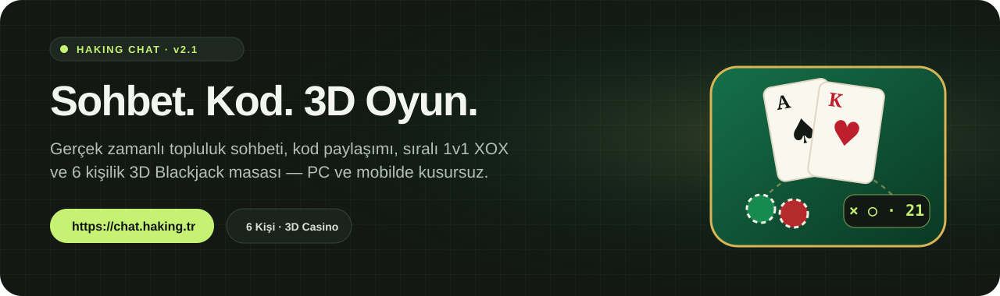

# Haking Chat

[](https://chat.haking.tr/)
[](https://chat.haking.tr/)
[](LICENSE)

Türkçe geliştirici topluluğu için gerçek zamanlı sohbet, kod paylaşımı ve çok oyunculu oyun alanı.  
Canlı adres: **[https://chat.haking.tr/](https://chat.haking.tr/)**



---

## Öne çıkan özellikler

### Sohbet, URL Rotaları ve Yetki Düzeni
- **Kanallara uyumlu arayüz**: `#genel-sohbet` yalnızca `Sohbet akışı` ve `Sabitlenenler` sekmelerini sunar; kod araçları sadece `#kod-paylaşımı` kanalında aktiftir.
- **Paylaşılabilir akıllı URL rotaları**:
  - `https://chat.haking.tr/` → `#genel-sohbet`
  - `https://chat.haking.tr/?kanal=kod` → doğrudan `#kod-paylaşımı`
  - `https://chat.haking.tr/?sayfa=oyunlar` → doğrudan `Oyun Alanı`
- **Ayrıştırılmış Kurucu & Moderatör yetkileri** *(tamamı backend doğrulamalı)*:
  - **Moderatör (`Moderasyon`)**: Süreli (`5 dk / 15 dk / 1 saat / süresiz`) ve sebepli susturma, ses açma, kanal yavaş modu (`5–60 sn`), odadan çıkarma, mesaj silme ve kanal başına 3 mesaj sabitleme.
  - **Kurucu (`Yönetim`)**: Tüm moderasyon yetkilerine ek olarak moderatör ekleme/çıkarma, ad değiştirme, kanalı kilitleme/temizleme, resmi duyuru yayınlama, oyun lobisini sıfırlama ve tam denetim günlüğü.
- **Açık / Koyu tema & Mobil kısayollar**: Mobilden yalnızca oyun için giren kullanıcılar için üst çubukta tek dokunuş **♠ Oyunlar** geçişi ve taşmasız responsive yerleşim.

### Oyun Alanı (`oyun-alanı`)
İleride yeni oyunların kolayca eklenebileceği modüler oyun merkezi şimdi 3 ana oyunla gelir:

1. **Blackjack 21 (3D · Canlı Kurpiyer · Max 6 Kişi)**
   - **Three.js 3D sahne + Kurpiyer avatarı**: Yerel `vendor/three/` ve MIT lisanslı 3D kadın kurpiyer modeli (`assets/models/dealer.glb`) ile maun/zümrüt kumarhane masası, 3D kart dağıtım ve çevirme animasyonları, 3D fiş yığınları ve `Masa` / `Elim` / `Üstten` kamera açıları (WebGL desteklemeyen cihazlarda otomatik 2D masa yedeği).
   - **Anında masa menüsü**: İlk oyuncu koltuğa oturduğu anda tüm masa kontrol paneli açılır.
   - **Başlat & Oto Başlat kuralı**: Masada oturanlardan **herhangi biri** `Başlat (10 sn)` tuşuna bastığında 10 saniyelik geri sayım başlar; **6 koltuğun tamamı dolduğunda** oyun otomatik olarak başlar.
   - **Profesyonel kurallar**: 6 deste karışım, **1.000 başlangıç fişi** (+ bakiye bitince +500 yenileme), `10–500` bahis, **Kart Çek / Dur / 2× Katla / Böl (Split)**, doğal Blackjack **3:2** ödeme, **Kasa tüm 17'lerde durur**, gizli kasa kartı koruması, 25 saniyelik AFK koruması ve masa içi hızlı tepkiler (`🔥 👏 😎 😱 🍀 💎`).

2. **Zar Düellosu 5.000 (3D · Anti-Ghost · 1–6 Kişi & Bot)**
   - **Sıfır gizli bilgi (Anti-Ghost)**: Yan yana ekranlarda oturan oyuncuların birbirinin ekranından hile yapabileceği gizli el/kart yoktur; masadaki tüm zarlar ve puanlar herkese açıktır.
   - **Three.js 3D zar masası**: MIT lisanslı pahlı 3D zar modeli (`assets/models/dice.glb`), sekizgen keçe zar tepsisi, zar fırlatma fiziği, 3D dokunma (raycasting) + mobilde başparmakla hızlı seçim çubuğu ve WebGL yoksa otomatik 2D mod.
   - **Esnek masa yapısı**: Tek kişi **Zar Botu ile 1v1**, arkadaşlarla **1v1** ya da **6 kişiye kadar çok oyunculu**; `3.000 / 5.000 / 10.000` hedef puan seçenekleri.
   - **Farkle kuralları**: `1=100`, `5=50`, üçlü ve katları (`4×/5×/6×`), `1-6 Sıralı (1.500)`, `Üç Çift (1.500)`, `İki Üçlü (2.500)`, tüm zarlar puan verirse **Sıcak Zar** hakkı ve risk alıp kasaya yazma stratejisi.

3. **XOX · Strateji Arenası (Sonsuz 3 Taş & Klasik · Tuzakçı Yenilmez Bot)**
   - **Sonsuz 3 Taş modu (`Beraberesiz`)**: Her oyuncunun tahtada en fazla 3 taşı kalır; 4. taşı koyduğunda en eski taşı silinir (`SONRAKİ GİDER` uyarısıyla titreşir), bu yüzden maç asla berabere bitmez!
   - **Kusursuz 1v1 Tekrar Oyna**: Maç sonunda `Tekrar oyna`ya basıldığında yeni oda olarak lobiye düşmez; doğrudan rakibin ekranına **Kabul et / Reddet** penceresi gider ve her elde **ilk başlayan taraf sıra sıra değişir** (`starterIndex`).
   - **Geliştirilmiş Yenilmez Bot**: Tuzak olasılığı en yüksek ve en hızlı bitiren hamleleri seçen çeşitlendirilmiş Minimax zekası.

---

## Mimarî ve yerel kurulum

Frontend derleme adımı gerektirmez; tarayıcı bağımlılıkları CDN olmadan `vendor/` klasöründen sunulur. Gerçek zamanlı sohbet ve oyun mantığı ayrı **`chat-backend`** sunucusunda çalışır.

```powershell
npm ci
npm run vendor
npm run dev
```

Tarayıcıda `http://localhost:5173` adresini açın. `config.js` içindeki `window.HAKING_CONFIG.backendUrl` yerelde `http://localhost:3000`, canlıda `https://chat-backend-qmzo.onrender.com` adresine bağlanır.

Doğrulama ve üçüncü taraf kontrolleri:

```powershell
npm run check
npm audit --audit-level=high
```

---

## Yayınlama (Cloudflare Pages + Render)

Ayrıntılı yayın sırası ve kontrol listesi: [docs/DEPLOYMENT.md](docs/DEPLOYMENT.md)  
Üçüncü taraf lisans ve 3D varlık bildirimleri: [THIRD_PARTY_NOTICES.md](THIRD_PARTY_NOTICES.md)

| Cloudflare Pages Ayarı | Değer |
| --- | --- |
| Framework preset | `None` |
| Build command | Boş |
| Build output directory | `/` (depo kökü) |
| Custom domain | `chat.haking.tr` |

> **Önemli:** `npm run vendor` çıktısı olan `vendor/` dosyaları ile `assets/models/dealer.glb` ve `assets/models/dice.glb` Git deposunda tutulur. Güvenlik başlıkları (`'wasm-unsafe-eval'` ve `blob:` dahil) [`_headers`](_headers) içindedir.

---

## Katkı ve lisans

[Katkı rehberi](CONTRIBUTING.md) · [Güvenlik bildirimi](SECURITY.md) · [MIT lisansı](LICENSE)
