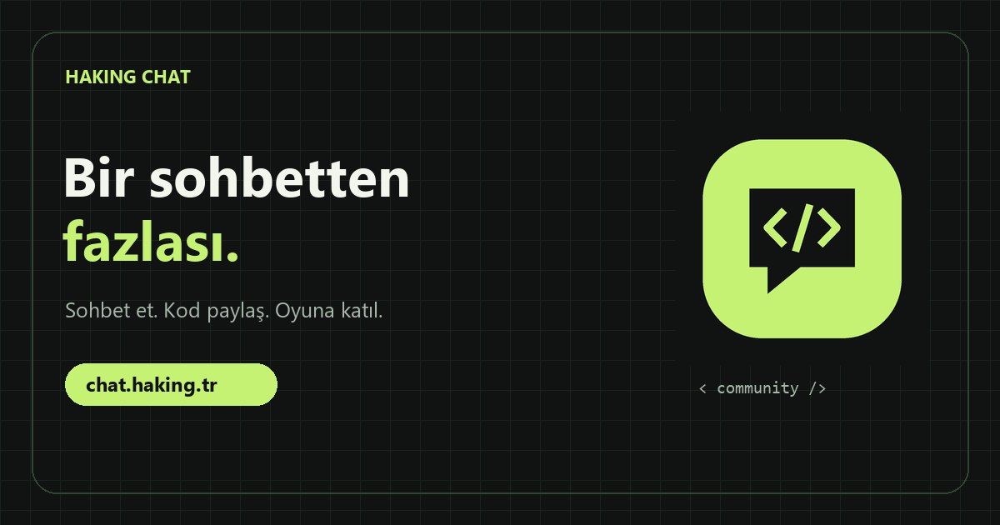

# Haking Chat

Sohbet, kod paylaşımı ve XOX için Türkçe topluluk alanı. Canlı adres: **[chat.haking.tr](https://chat.haking.tr/)**.



## Neler var?

- Gerçek zamanlı sohbet, konu kanalları ve çevrimiçi kullanıcılar.
- Kod paylaşımı, yanıtlar ve mesaj etkileşimleri.
- Ayrı kurucu ve moderatör rolleri; sunucuda doğrulanan yetkiler.
- Kurucuya özel moderatör listesi ve çevrimiçi durumları. Mevcut Halit/Panda/Nurullah/Sosyal Enik girişleri önceki parolalarıyla korunur.
- Takma adlarda küfür ve yetkili taklidi kontrolü. Sohbet metni sansürlenmez.
- Oyuncu bekleme lobisi, kullanıcılar arası XOX ve güçlü bot.
- Mobil arayüz, açık/koyu tema ve özgün logo/favicon seti.

Frontend düz HTML, CSS ve JavaScript ile çalışır. Paket derlemesi gerektirmez; istemci kütüphaneleri yerel `vendor` dosyalarından yüklenir. Gerçek zamanlı özellikler için **ayrı `chat-backend` sunucusu** gereklidir; yalnızca frontend'i yayınlamak yeterli değildir.

## Yerelde açma

Önce `chat-backend` deposunun README dosyasına göre backend'i kurup başlatın. Ardından bu klasörde:

```powershell
npm install
npm run vendor
npm run dev
```

Tarayıcıda `http://localhost:5173` adresini açın. `config.js` içindeki `window.HAKING_CONFIG.backendUrl`, yerelde `http://localhost:3000`, yayında `https://chat-backend-qmzo.onrender.com` adresini kullanır. Başka bir backend kullanıyorsanız bu dosyayı düzenleyin. `file://` üzerinden açmayın.

## Yayın

Frontend Cloudflare Pages, backend mevcut Node.js/Socket.IO uyumlu sunucu üzerinde yayınlanır. Ayrıntılı sıra ve kontroller: [docs/DEPLOYMENT.md](docs/DEPLOYMENT.md).

Mevcut alan adları ve yetkili girişleri hazırdır; önce backend'i, ardından frontend'i push edebilirsiniz. Yeni SQL/veritabanı kurmanız gerekmez. İleride yeni moderatör eklemek için backend'de `npm run staff:add` komutuyla `config/staff.json` güncellenir ve push edilir. Kurucu panelinden canlı ekleme/silme, yalnızca kalıcı moderatör kayıt dosyası yapılandırıldığında açılır.

Cloudflare Pages ayarları:

| Alan | Değer |
| --- | --- |
| Framework preset | None |
| Build command | Boş |
| Build output directory | `/` (depo kökü) |
| Custom domain | `chat.haking.tr` |

`npm run vendor` ile hazırlanan yerel kütüphane dosyalarını Git'e dahil edin; böylece Cloudflare'da kurulum veya derleme komutu gerekmez. Cloudflare `_headers` dosyası güvenlik ve önbellek başlıklarını tanımlar. Backend alan adı değişirse hem `config.js` bağlantı yapılandırmasını hem `_headers` içindeki `connect-src` listesini güncelleyin. Kurucu/moderatör parolalarını frontend'e yazmayın.

## Arama ve paylaşım

`robots.txt`, `sitemap.xml`, sosyal paylaşım görseli ve uygulama ikonları bu depodadır. Site adresi değişirse canonical/Open Graph adreslerini, robots ve sitemap dosyalarını güncelleyin. Alan adını Google Search Console ve Bing Webmaster Tools'a ekleyip `https://chat.haking.tr/sitemap.xml` adresini gönderin. Bu hesap doğrulamaları depo dosyalarıyla otomatik tamamlanmaz; indekslenme veya sıralama garantisi yoktur.

## Katkı ve lisans

[Katkı rehberi](CONTRIBUTING.md) · [Güvenlik bildirimi](SECURITY.md) · [MIT lisansı](LICENSE)

Depoya gelen üçüncü taraf kütüphaneler kendi lisanslarını korur. Kullanıcıların paylaştığı içeriklerin hakları ilgili sahiplerine aittir; uygulamanın MIT lisansı sohbet içeriğine otomatik uygulanmaz.
